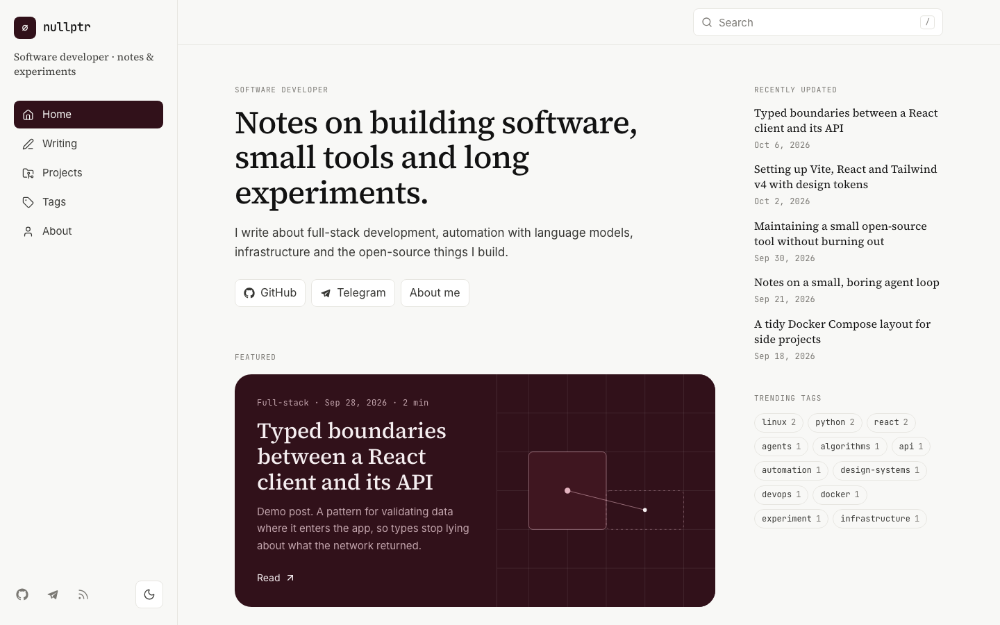
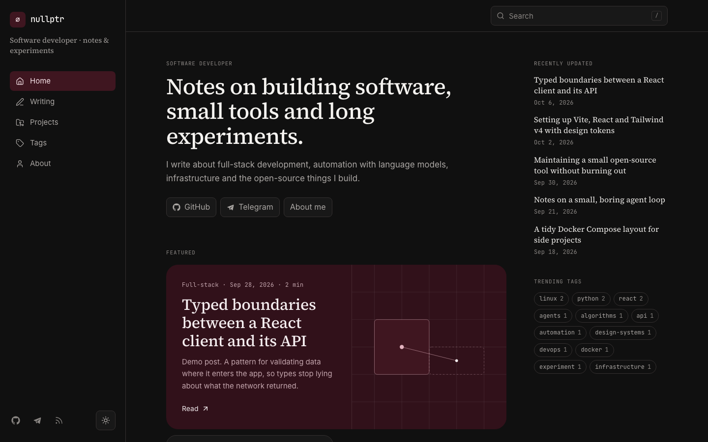
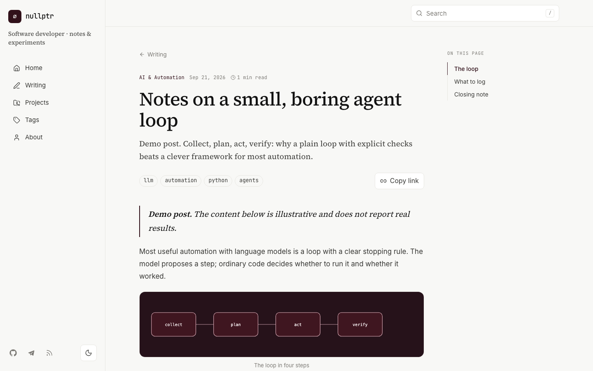
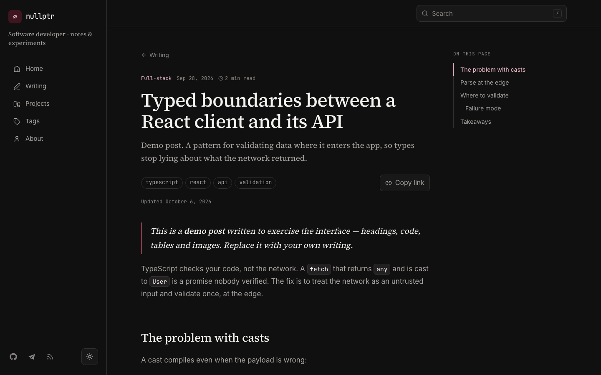
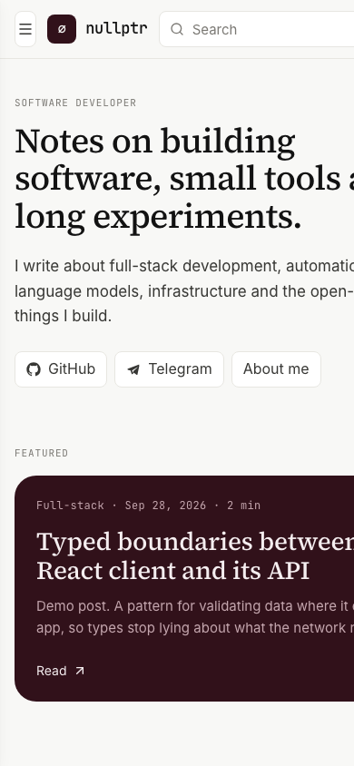
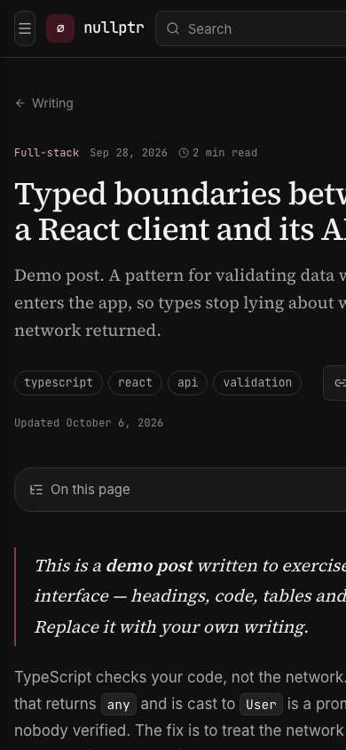

# ∅ nullptr

**Personal site & technical notebook** — minimal, editorial, cherry‑dark. 🍒

Notes on full‑stack development, AI automation, infrastructure and open‑source experiments.

  
  

## ✨ Highlights

- 🎨 **Claude‑style design, own identity** — editorial serif headings, soft 1px borders, calm motion, and a dark‑cherry palette (`#31111A` · `#3F1620` · `#101010`) driven by CSS variables.
- 🌗 **Light & dark themes** — saved choice, no flash on load, smooth colour transition.
- 🔎 **Instant search** — titles, descriptions, tags and full text, with `/` and `⌘K` shortcuts.
- 📝 **Markdown posts** — syntax highlighting, copy‑code buttons, heading anchors, tables, figures.
- 🧭 **Live table of contents** — active section follows your scroll.
- 🏷️ **Categories, tags & pagination** — filter everything from the URL.
- 📱 **Responsive** — from 320px phones to wide desktops, sidebar becomes a drawer.
- 🚀 **SEO ready** — per‑page meta & Open Graph, sitemap, robots.txt, RSS feed.
- ♿ **Accessible** — keyboard navigation, focus rings, `prefers-reduced-motion`.

## 📸 Screenshots

  
  

  
  

## 📄 License

This work is licensed under the [Creative Commons Attribution 4.0 International License (CC BY 4.0)](https://creativecommons.org/licenses/by/4.0/).

You are free to **share** and **adapt** the material for any purpose, even commercially, as long as you give **appropriate credit** to **nullptr**, provide a link to the license, and indicate if changes were made.

  

